# Website process flows

These diagrams describe the migration working tree, not a claim that every flow
has passed deployed parity testing. They describe website infrastructure, not
the internal execution of every package or background job.

## Who owns what

| Concern                                                               | Owner                                | Boundary                                                 |
| --------------------------------------------------------------------- | ------------------------------------ | -------------------------------------------------------- |
| HTTP document handling and website RPC transport                      | Start                                | Native file routes and typed server functions            |
| Matching, URL/search state, navigation, preload, scroll, route errors | Router                               | Loaders coordinate readiness, not a second payload cache |
| Reusable server data, freshness, mutation status and reconciliation   | Query                                | Keys include actor and resource scope                    |
| Rendering, local drafts and component lifecycle                       | Redact through React-compatible APIs | Local UI state is not authoritative saved data           |
| Identity, permissions, write leases, audit events and business rules  | Kody server/domain code              | Enforced on each operation, independent of the UI        |
| Durable records and objects                                           | Existing database/storage services   | The migration does not require a new data model          |
| Cookie, schema, table and HTML helpers                                | Retained Remix leaf utilities        | No website routing or action dispatch ownership          |

## 1. Initial page request and hydration

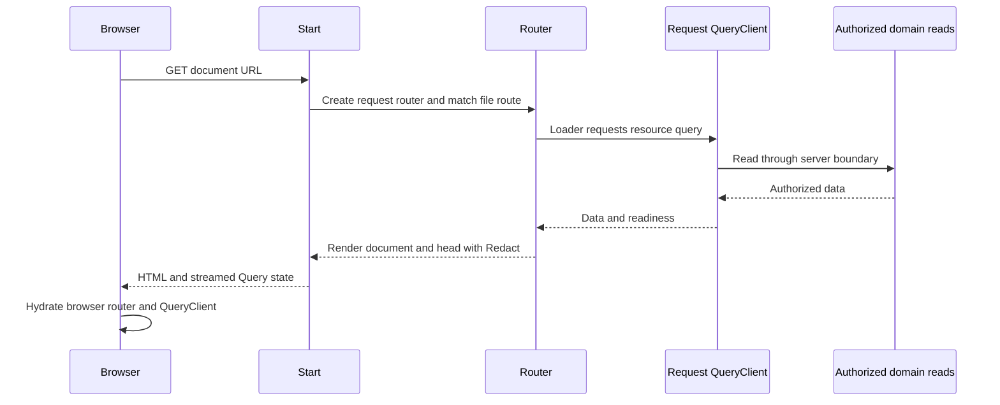

Each server request gets its own QueryClient. The browser retains its own client
across navigation. Successful and pending queries can be dehydrated for
streaming; settled authorization errors are not reusable hydration data.

## 2. Navigation and private access

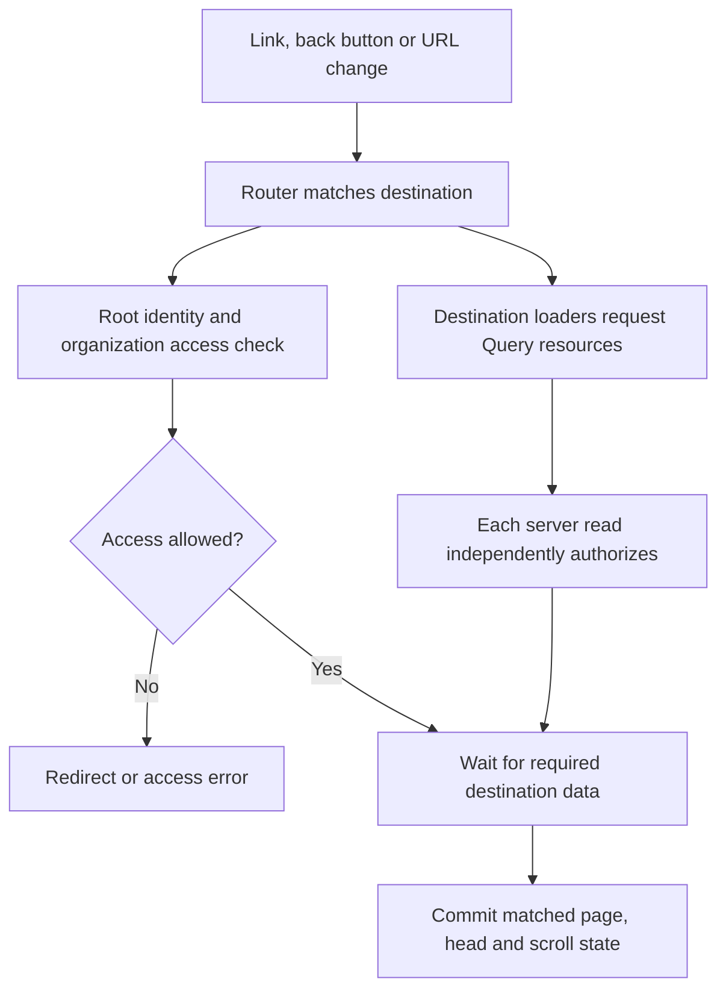

Identity checks and destination reads start concurrently. Private warm
navigation can reuse data but still checks access. Known static public pages
skip that check. Permission-sensitive resources explicitly require fresh
foreground authorization. Retained pages use their matched location while the
next navigation is pending.

## 3. Repeated reads and performance

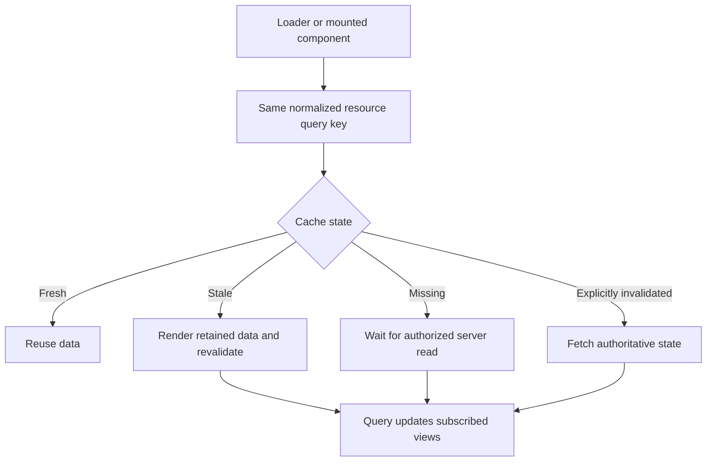

Default freshness is 30 seconds and inactive cache retention is 5 minutes, with
resource-specific overrides possible. Query owns freshness even for intent
preloads. Automatic retries are disabled by default. Cancellation belongs to the
query, not an individual navigation that might share it.

Performance comes from reuse, deduplication and starting independent reads
together. More granular reads are not automatically faster: email detail uses
parallel list, detail and destination RPCs, trading reuse for more requests.
Production performance still needs matched measurements.

## 4. Website mutation

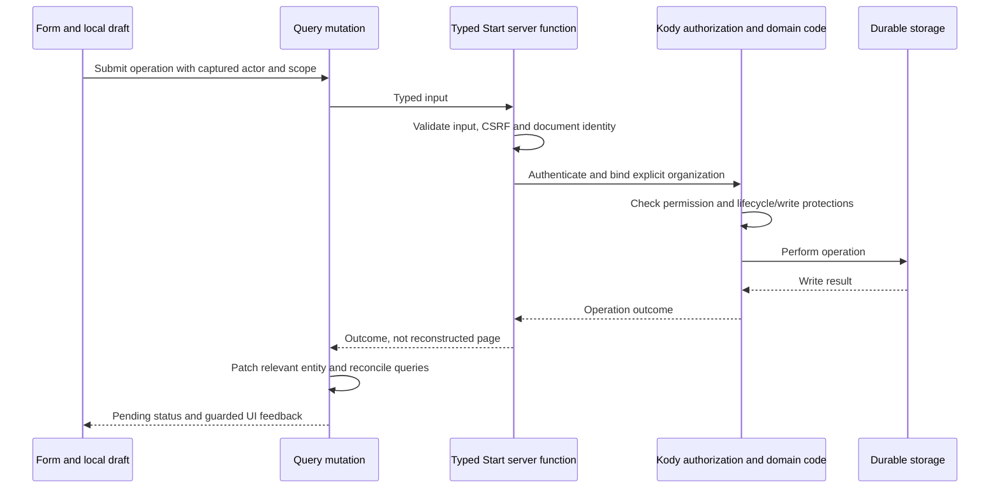

The organization is explicit validated input, not inferred from Referer. Shared
domain code retains resource authorization, relevant rate limits and audit
events. Normal website writes use an account write lease; account deletion has
its own exclusive lifecycle lock. Private responses use `private, no-store`.

## 5. Optimism, failures and navigation during a write

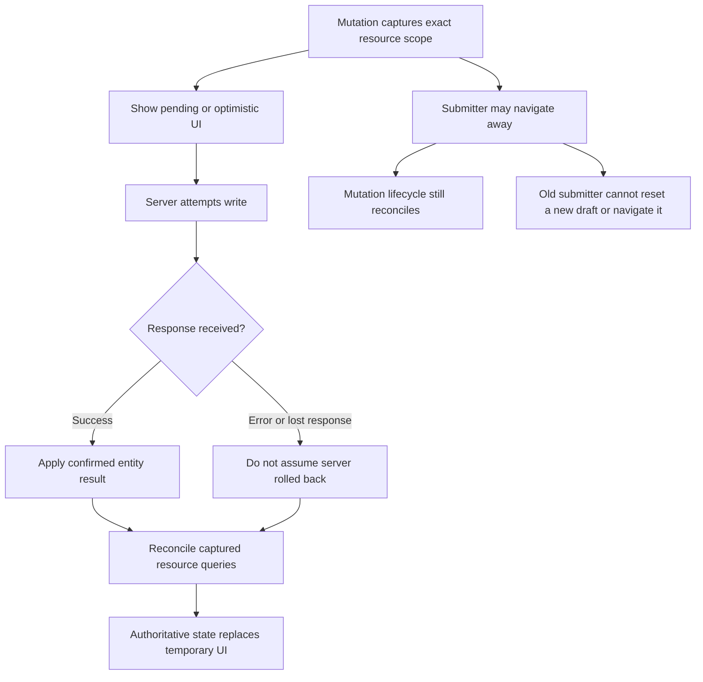

Pending mutations supply temporary presentation state over Query's saved data.
Reads continue independently, including first navigation reads. Settlement
preserves those first-read promises, then confirms the captured actor and
resource scope, including inactive queries and writes whose responses were lost.
There is no global table that blocks reads by mutation family.

## 6. State ownership

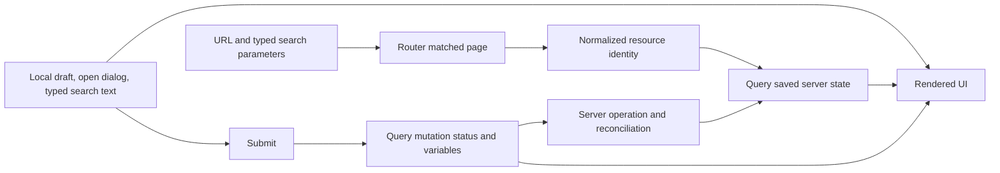

Presentation-only filters can change the URL without fetching the same data
again. Draft text can retain whitespace while query inputs normalize it. Secrets
and one-time credential or invite reveals stay outside reusable page caches.
Pending controls follow mutation status, not a local flag that can get stuck
when navigation changes.

## 7. Tab activation, session changes and refresh

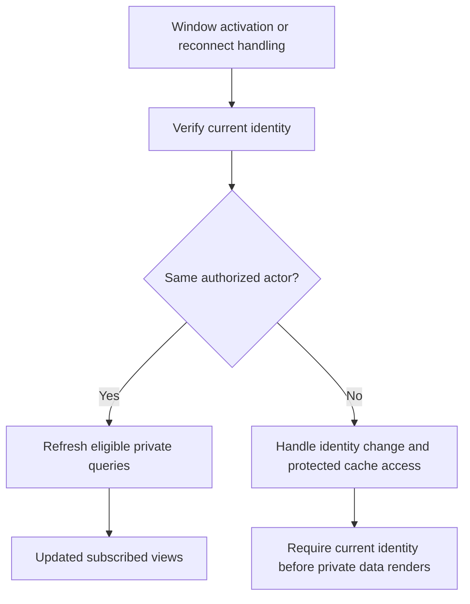

Default Query focus/reconnect refetches are disabled. Kody's activation handler
checks identity first. Query metadata carries actor identity so refresh and
permission invalidation do not depend on a registry of page names.

## 8. One-time links, redirects and SEO

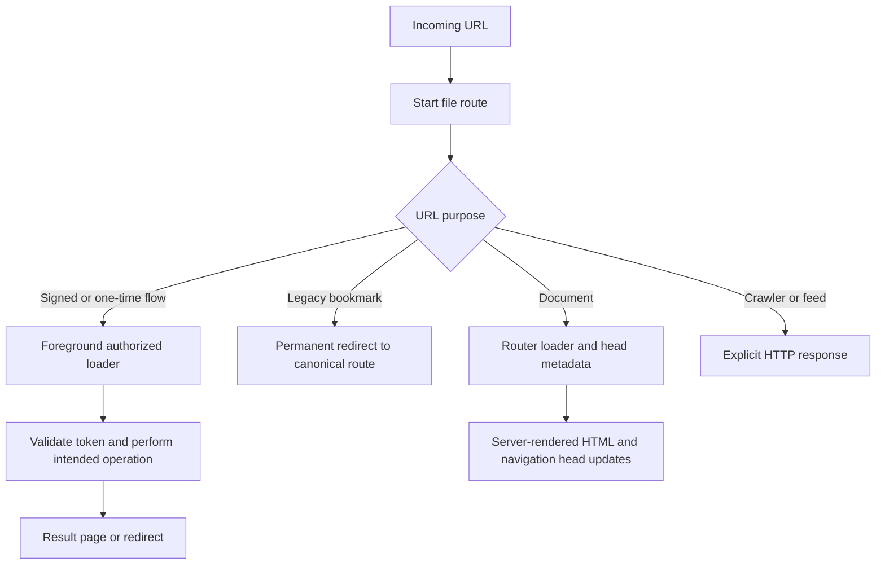

One-time results do not enter a reusable resource cache. HEAD cannot consume
signed verification links. A failed request is not dispatched again to render an
error, since its operation may already have committed. Redirects, metadata and
token flows still need parity verification, not just a successful build.

## 9. External protocols and shared business logic

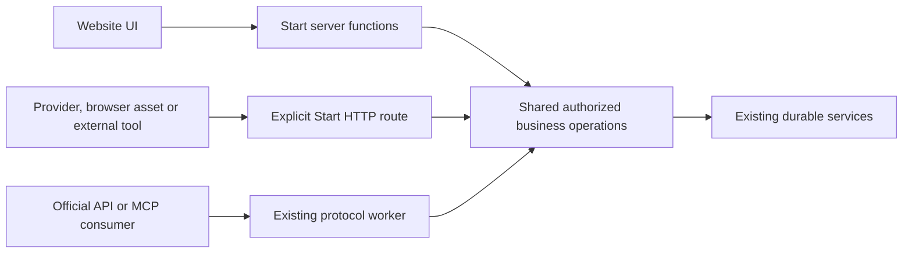

External OAuth callbacks, webhooks, downloads, assets, discovery and health URLs
retain HTTP contracts. They do not justify a second website action router. See
[the endpoint inventory](./tanstack-start-http-contracts.md) for exact methods,
paths and consumers. User-authored package apps remain a separate runtime
concern.

## 10. Verification and deployment

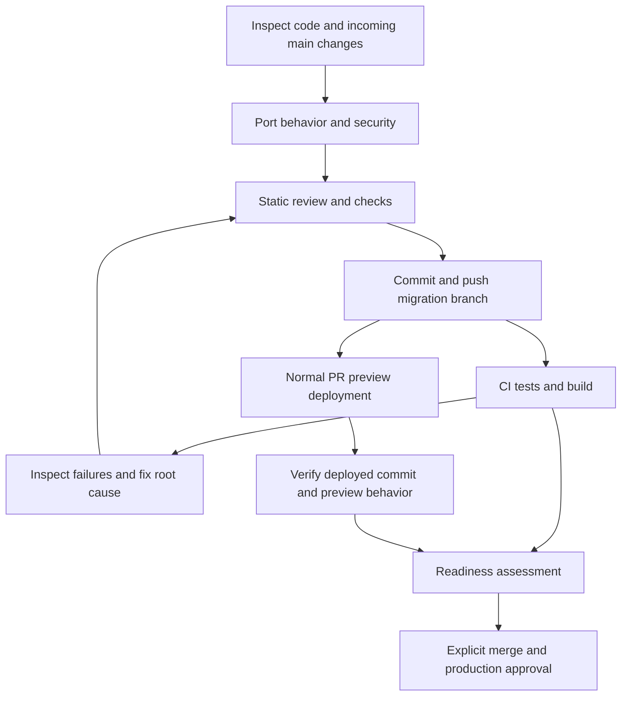

The current workflow skips local runtime tests before catch-up pushes by user
request. CI success does not prove visual or authenticated action parity. The
[parity audit](./tanstack-start-parity-audit.md) tracks evidence and gaps.

## 11. Anonymous document caching

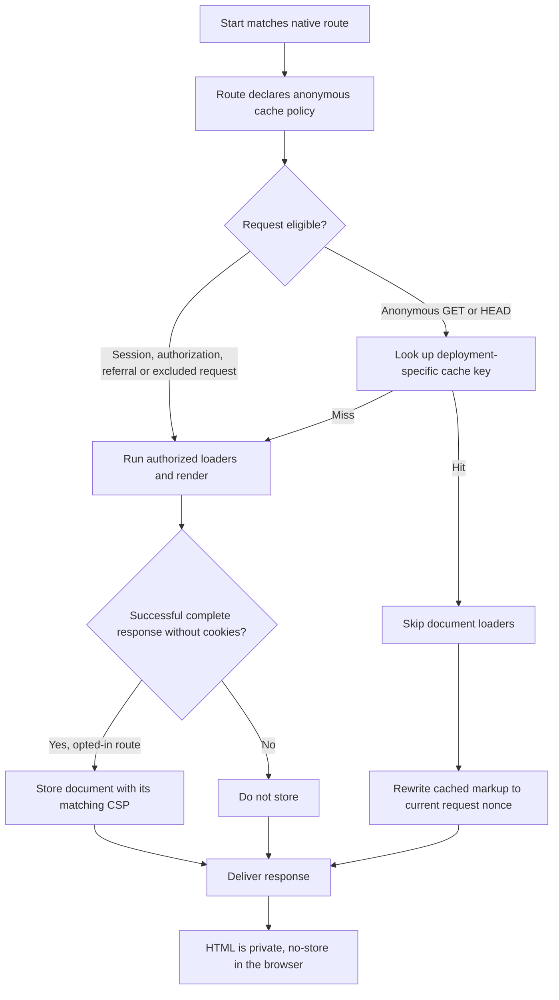

Native route metadata owns eligibility and the marketing or visibility-sensitive
TTL. Cache keys include the Worker version so a deployment cannot replay old
asset references. Cached HTML receives a fresh nonce that matches the delivered
CSP. HEAD returns no body and does not populate the cache. Method guards reject
actionable HEAD requests before document loaders. This lifecycle awaits CI
verification; it is not yet deployed evidence.

Implementation details and source links:
[web architecture](./tanstack-start.md).
